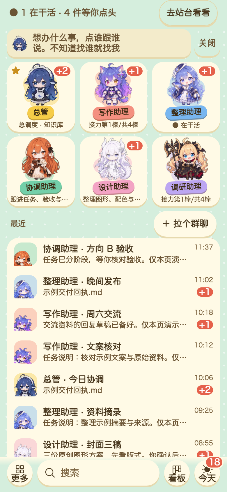
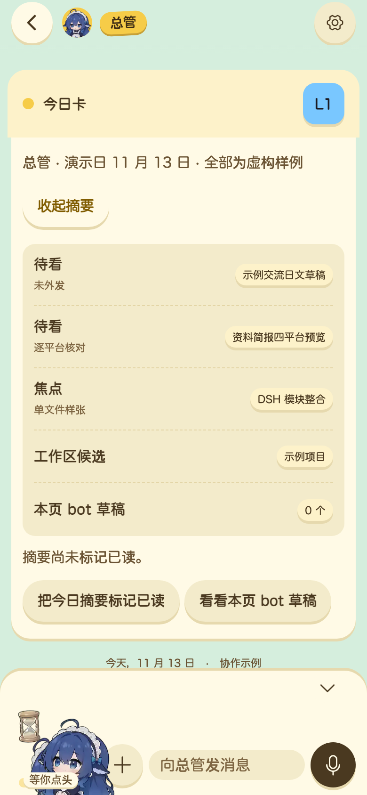
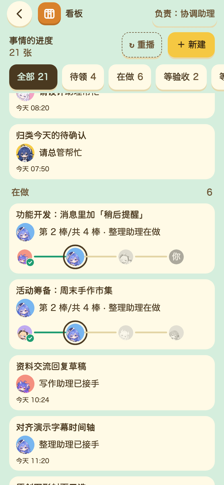
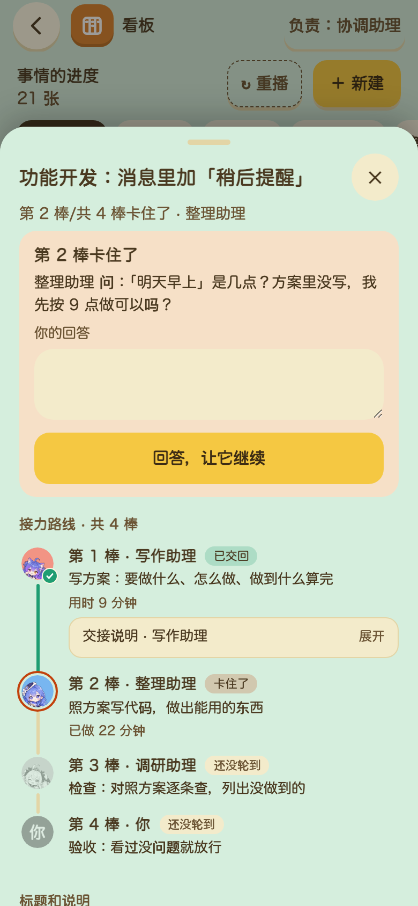
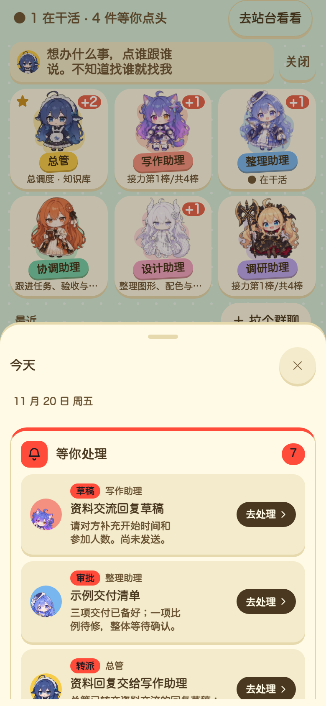
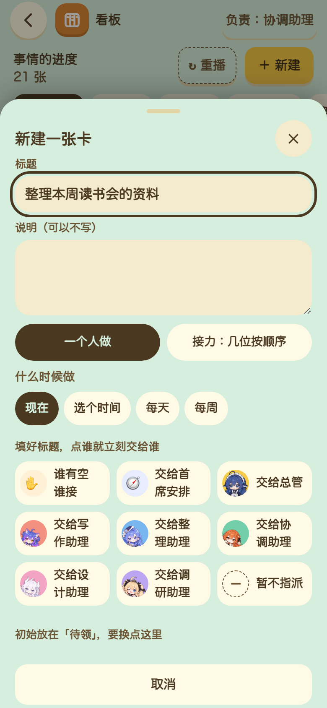
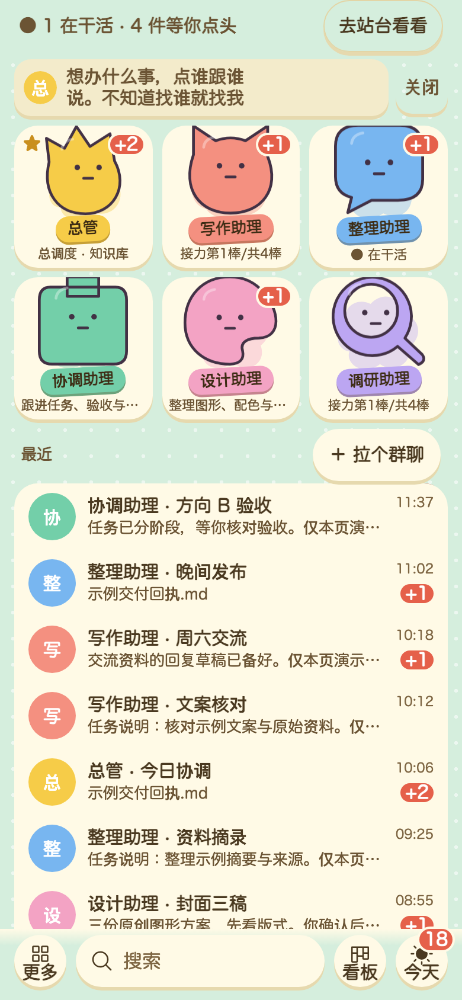

# Super DeepSeek Harness Bot（超级 DSH）

> **非官方、社区开源项目，与 DeepSeek、xAI 等公司无关；基于 DeepSeek Harness（MIT）。**
> 项目代码与文档采用 MIT；`shell/pets/` 里的角色形象是**第三方同人素材，采用 CC BY-NC-SA 4.0（仅限非商业），不在 MIT 范围内**，见下文「角色形象」。
> 当前是 **v0.1.0-beta 测试版**，请当测试版看待。

**English.** Super DeepSeek Harness Bot ("Super DSH") is an unofficial, community, phone-first hub that sits on top of
the DeepSeek Harness kernel. Two headline features: **a group of Personal Bots** (talk to one
lead assistant; it hands work to a small team of assistants, each with its own avatar, tracked on a kanban board, with a
ledger and confirm-before-risky-actions) and **a task board with relay** (one card carries a whole route; the next
assistant is woken automatically with a hand-off note; the lead assistant can arrange who does what and when; external
agents such as Codex, Claude Code or Grok take cards through a small CLI). It runs on your own machine. Status: beta,
developed on macOS, docs mostly in Chinese for now, **contributions and English translations are very welcome**.
License: MIT for code and docs; the character art in `shell/pets/` is third-party fan art under CC BY-NC-SA 4.0 (non-commercial) and is not covered by MIT.

演示视频：即将发布

---

## 一句话

在 DeepSeek Harness（DSH）内核之上，给你一个**手机优先的个人助理中枢**：你只和首席助理说话，它带着一小队带形象的助理替你干活，进度全在一块任务板上；全部跑在你自己的机器上。

## 两大功能

### 一、一群 Personal Bot
你只和首席助理说话，它把活派给几位同事；每位有自己的名字、形象和待办，进度落在看板上，花了多少记在账本里。
对话、传文件、拉群讨论、今天页、账本都在手机宽度下做过。权限默认全开，也可以一键切到「改动前问」或「只读」；
**花钱、对外发送、删除、上线或动线上服务这四类，一定先问主人**。

### 二、任务板与接力
一块任务板，一件事一张卡：

- **派给谁**：点名交给某位助理，或交给外部 agent；**谁有空谁接**：不指定人，空闲的助理自己来领。
- **交给首席安排**：不想自己挑，就交给首席——它读卡片、看各位的职责，决定交给谁、什么时候做；碰到花钱、对外发送、删除、动线上服务，或要派给外部 agent，会先停在「等你处理」让你点头。
- **定时**：现在 / 选时间 / 每天 / 每周；错过的有交代。
- **接力**：一张卡带一条路线（2 到 8 棒），一棒交回，后端自动叫醒下一棒并带上交接说明；可以要求某一棒「要我看一眼」才放行；最后有总验收。
- **卡住会问**：助理卡住了会停下来，今天页出现「等你处理」，你回答后继续。
- **外部 agent 用命令行领单**：Codex、Claude Code、Grok 等用 `hub-handoff` 看板命令领单、交回；仓库里带一个「接单器」（[tools/runner](hub/tools/runner/)），没单时一次模型都不调。外部身份和令牌要你自己配，默认关闭。

详见 [docs/接力.md](docs/接力.md) 与 [docs/任务板与外部agent.md](docs/任务板与外部agent.md)。

## 截图

全部是仓库自带的虚构演示数据（手机宽度 390×844）。六位助理的形象都是第三方同人素材（首席是动图「蓝毛小女仆」，其余五位是 CrossPet 的静态立绘，出处与许可见下文「角色形象与许可边界」）；没有这些素材时界面用自绘的示意团子。

| 首页 | 对话 | 看板（接力卡） |
| --- | --- | --- |
|  |  |  |

| 接力时间线 | 今天（含等你处理） | 新建任务 |
| --- | --- | --- |
|  |  |  |

删掉 `shell/pets/` 目录之后六位助理都会变回自绘示意形象：



## 两分钟上手

### A. 只看演示（不需要后端、不需要钥匙、不联网）

需要 Python 3（只用标准库）。

```sh
cd shell
python3 build.py                  # 打出 dist-generic/DSH-Hub.html（单个文件，约 2 MB）
open dist-generic/DSH-Hub.html    # 或直接双击；里面是虚构的演示数据
```

想看到助理们的形象（首席带动作，其余五位按状态换姿态），用一个本地静态服务打开（浏览器不允许 `file://` 页面读取旁边的图片）：

```sh
python3 -m http.server 8000 -d dist-generic   # 然后打开 http://127.0.0.1:8000/DSH-Hub.html
```

### B. 接真后台（要装 DSH 内核）

需要 Node 22 或更新，以及你自己装好的 DSH 内核（实测区间 `>=0.2.2-rc.1 <0.2.3`，本仓库不含它）。
先跑一个隔离的演示实例，假模型、虚构数据、只听 127.0.0.1：

```sh
cd hub
scripts/doctor.sh --target /绝对路径/demo           # 体检：缺什么、怎么办
scripts/start.sh --demo --target /绝对路径/demo     # 起，约两秒，会打印带一次性钥匙的本机地址
scripts/stop.sh  --target /绝对路径/demo            # 停
```

接你自己的模型、自己的助理，见 [docs/安装.md](docs/安装.md)。

## 现在做到哪（如实说）

**真模型下验过**（作者本人的环境，样本不多）：对话与派活、看板、接力三棒自动走、卡住回答后继续、「交给首席安排」、一次性定时、
Grok CLI 与 Claude Code 各真接了一张卡、Codex 经接单器接了一张卡。

**只在测试里验过**（单元测试、假时钟、假执行器，没有真模型跑过）：重复定时、夜间不打扰、错过补跑、外部拉起的失败/超时/重试/每日上限、
接棒助理被停用后换人、一棒超时催办。

**没做 / 没通**：
- **语音转文字没接**：录音能存能发，但没有转文字引擎。
- **Gemini 没接通**：配置模板在，但作者试跑时官方个人版客户端已不被支持，**未验证**。
- **只在 Mac 上用过**；界面在 iPhone Safari 的主屏幕模式下用过，**但作者本人尚未在 iPhone 上对这一版做系统验收**。Android、Windows、Linux、其它手机浏览器没验。
- 界面以竖屏手机为主；平板和宽屏只是能用。文档以中文为主，英文只有简介。
- 这是测试版：数据格式可能变，升级前请自己备份运行目录。

## 权限与安全

- **默认全开档**：助理能跑命令、读写文件、联网读取。**花钱、对外发送、删除、上线或动线上服务这四类，一定先问主人，主人点头才执行**；一键全停优先于任何档位。
- 权限层是**第二道门**，第一道是 DSH 内核沙箱和一个专用的低权限系统用户，请先把第一道配好。
- **只建议在私网里用**：默认只听 `127.0.0.1`；给手机用请放在你信任的私有网络里，**不要把端口暴露到公网**。
- 模型读到的网页和文件当作资料而不是命令，但这是约定不是保证。
- 详见 [docs/安全与权限.md](docs/安全与权限.md)；发现漏洞请看 [SECURITY.md](SECURITY.md)（私下报告，别在公开 issue 里贴利用细节）。

## 怎么参与

欢迎一起改。**[CONTRIBUTING.md](CONTRIBUTING.md)** 里有：怎么跑测试、已知失败是哪几条以及原因、
**想要帮忙的方向清单**（语音转文字接入、Linux/Windows 验证、Gemini 接入、英文界面、角色包规范……都有新手能下手的题目），
还有提 issue 和 PR 的约定。不确定从哪下手，开个 issue 说一声就行。

## 目录

```
shell/   界面壳（纯静态网页，python3 build.py 出单文件）；shell/pets/ 是第三方角色素材（CC BY-NC-SA 4.0）
hub/     后端：hub-bff（接 DSH 的服务）、hub-plugin（权限层）、hub-web（网页服务与适配层）、tools/runner（外部 agent 接单器）
docs/    使用文档：安装、安全与权限、接力、任务板与外部 agent、角色包怎么自备、常见问题
```

各包里的 README、`hub/COMPAT.md` 是开发笔记，保留了一些历史代号，不是用户文档。

## 角色形象与许可边界

**MIT 只覆盖代码与文档。`shell/pets/` 目录下的角色素材采用 CC BY-NC-SA 4.0（署名、非商业、相同方式共享），版权属于各自作者，不在 MIT 范围内。**

- 仓库带六位，逐位的形象来源、原设、许可、来源地址、改动都写在 [shell/pets/CREDITS.md](shell/pets/CREDITS.md)：
  - 首席助理的「蓝毛小女仆」（DeepSeek 娘「大肥鱼」）：形象设计 B 站 @ZipZipPipe，动画素材来自开源项目 [PC2005-cloud/dsh-pet](https://github.com/PC2005-cloud/dsh-pet)，经 [hunmer/aboutme-pets](https://github.com/hunmer/aboutme-pets) 汇集；我们做了裁切和 4 倍超分。
  - 其余五位（Grok、GPT、Claude、千问、Gemini 的拟人形象）：**原样取自 [CrossPet](https://github.com/lokicorvus/crosspet) 的立绘**（字节没改，每个文件的 SHA-256 见 `shell/pets/MANIFEST-crosspet.txt`），该项目的 `characters/LICENSE.md` 明确允许转载与二创（CC BY-NC-SA 4.0）。原设作者 B 站 @ZipZipPipe 等，署名见 CREDITS。
- **非官方同人形象，与各 AI 公司无关；Claude、GPT、Grok、Gemini、Qwen、DeepSeek 等为各自公司的商标。**
- 别的角色（比如 hunmer/aboutme-pets 里另外生成的那批动作包）因为没有许可声明，**没有随仓库带**。
- 想商用，或者不想用这些形象：**删掉整个 `shell/pets/` 目录**，界面会自动换成自带的示意形象。
- **如果你是原作者并对使用方式有异议，请提 issue，我们会第一时间修改或移除。**
- 想用自己的角色包：见 [docs/角色包怎么自备.md](docs/角色包怎么自备.md)。

## 致谢

- DeepSeek Harness（MIT）：本项目运行在它之上；本仓库不含它的任何源码。
- CrossPet（lokicorvus 和贡献者）：站台桌宠的动作与状态机改编自它的代码（MIT，版权声明随附）；`shell/pets/` 里 Grok、GPT、Claude、千问、Gemini 五位的立绘取自它（CC BY-NC-SA 4.0，原设作者 B 站 @ZipZipPipe 等，署名见 [shell/pets/CREDITS.md](shell/pets/CREDITS.md)）。
- 角色形象「蓝毛小女仆」：ZipZipPipe（设计）、PC2005-cloud/dsh-pet（动画素材）、hunmer/aboutme-pets（汇集转码），CC BY-NC-SA 4.0，非官方同人，详见 [shell/pets/CREDITS.md](shell/pets/CREDITS.md)。
- Phosphor Icons（MIT）、以及一批只学了做法的开源项目，完整清单见 [CREDITS.md](CREDITS.md)。

## 许可证

代码与文档：[MIT](LICENSE)。`shell/pets/` 下的角色素材：CC BY-NC-SA 4.0（见 [shell/pets/LICENSE](shell/pets/LICENSE)），不在 MIT 范围内。变更记录见 [CHANGELOG.md](CHANGELOG.md)。
